# Compass Content Trend Radar

> A content intelligence workspace that turns client profiles, search trends, TikTok signals, SEO research, and brand rules into a practical weekly content plan.

Compass was designed for marketing teams that need more than a trend list. It connects audience context, keyword intent, source reliability, content scoring, approvals, briefs, and reporting into one guided workflow.

## Project Snapshot

| Area | Summary |
| --- | --- |
| Product | Internal content strategy and trend radar workspace |
| Users | Content strategists, growth marketers, creative teams, account managers |
| Core workflow | Client profile -> trend collection -> keyword intent -> content ideas -> briefs -> weekly board -> report |
| Backend | FastAPI service with collector, scoring, AI, strategy, and reporting modules |
| Frontend | React/TanStack workspace with dashboard, keywords, ideas, briefs, board, reports, guide, and profile views |
| AI role | Optional suggestion and generation layer with deterministic fallback behavior |
| Data model | Local JSON/CSV/Markdown outputs for prototype speed and transparent inspection |

## Feature Highlights

- Client profile workspace with brand tone, audience, services, markets, and risk boundaries.
- Google Trends and TikTok source collection with source health visibility.
- SEO keyword research, intent classification, search-volume estimation, and priority scoring.
- Weekly content idea generation with approval and review states.
- Production briefs and content scene generation for creators.
- Weekly content board for moving ideas toward execution.
- Report preview and export-ready strategy summaries.
- Optional realtime workflow notifications through Pusher.
- Safe collector posture: no aggressive scraping, no login bypass, no hidden automation claims.

## Architecture Preview

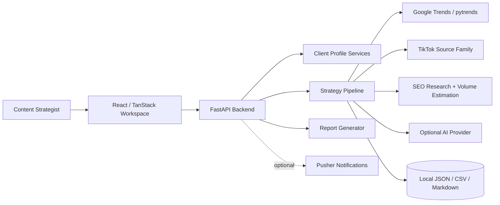

[View architecture details](docs/03-system-architecture.md)

## AI Workflow Preview

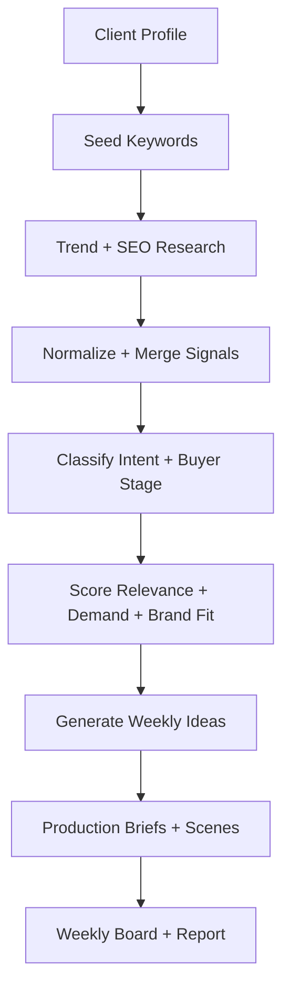

[Explore the strategy pipeline](docs/05-content-strategy-pipeline.md)

## Technology Stack

| Layer | Technologies |
| --- | --- |
| Frontend | React 19, TanStack Router, TanStack Query, Vite, Tailwind CSS, Radix UI, Recharts |
| Backend | Python, FastAPI, Uvicorn, Pydantic-style request/response contracts |
| Trend sources | Google Trends via pytrends, TikTok source adapters, Apify-enabled collection lane |
| AI | OpenAI-compatible generation path with rule-based fallback |
| Notifications | Optional Pusher integration |
| Storage | Local JSON, CSV, Markdown files for raw, processed, and report artifacts |
| Validation | Pytest-style backend tests for collectors, strategy services, and scoped overlays |

## Screenshot Gallery

<strong>Command Center</strong>

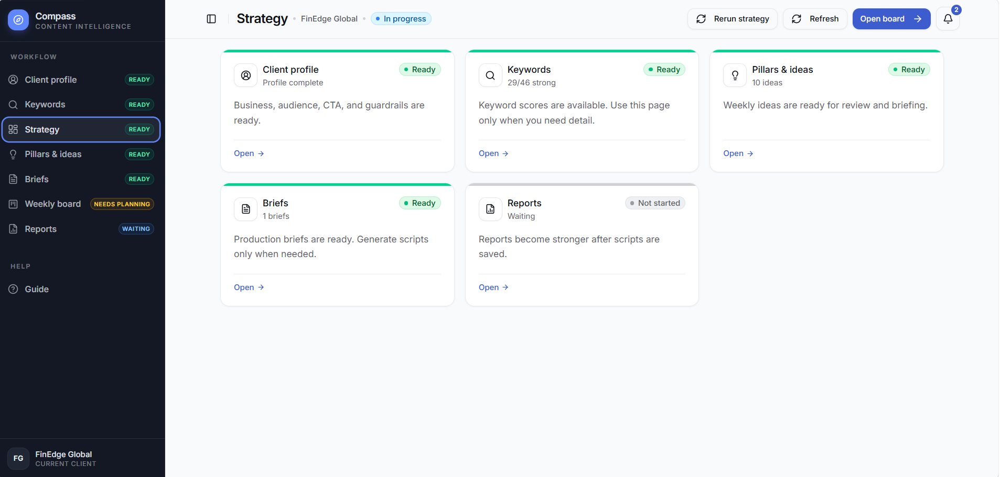

The dashboard shows the active client, strategy readiness, workflow status, source-aware progress, and the next operational step.

<strong>Research And Strategy Views</strong>

| Keywords | Ideas |
| --- | --- |
| 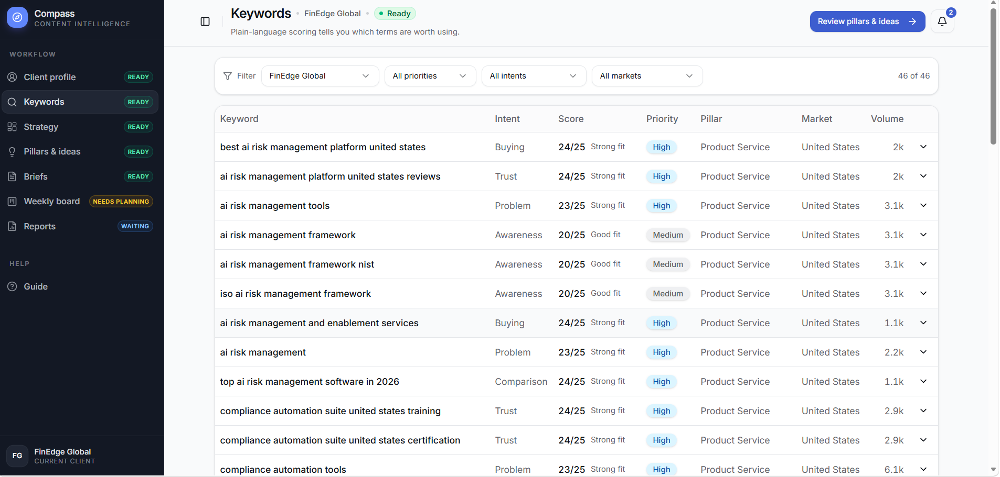 | 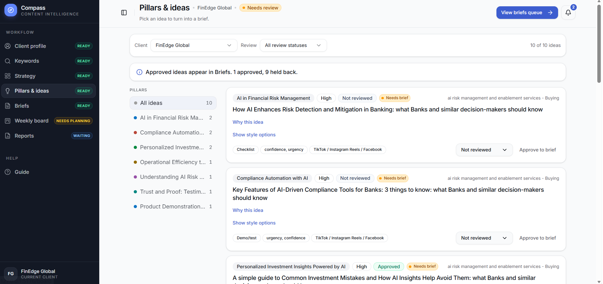 |

| Briefs | Brief Detail |
| --- | --- |
| 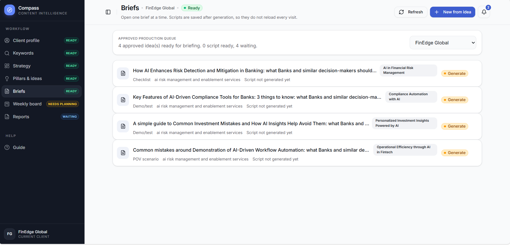 | 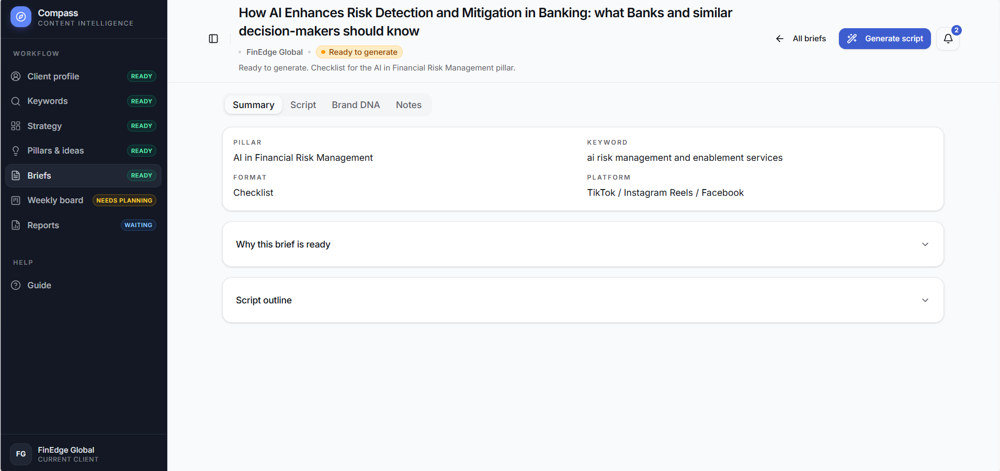 |

<strong>Planning, Reporting, And Client Context</strong>

| Weekly Board | Reports |
| --- | --- |
| 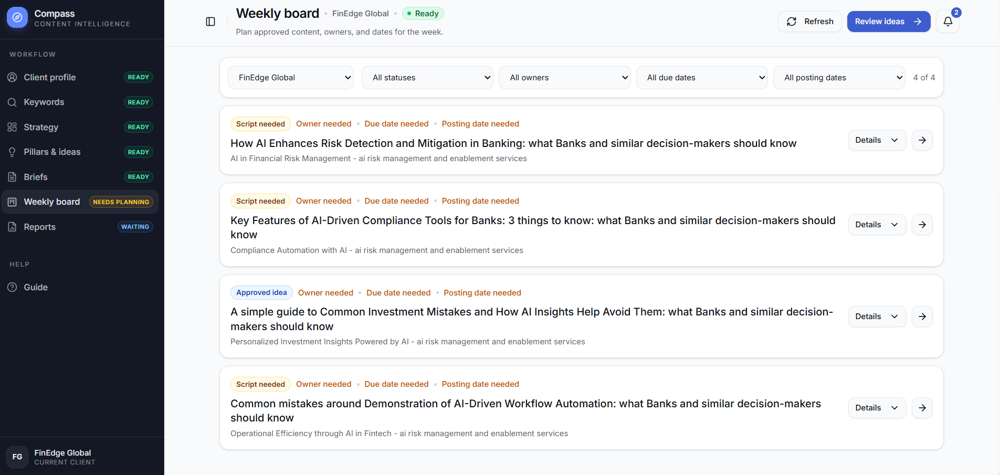 | 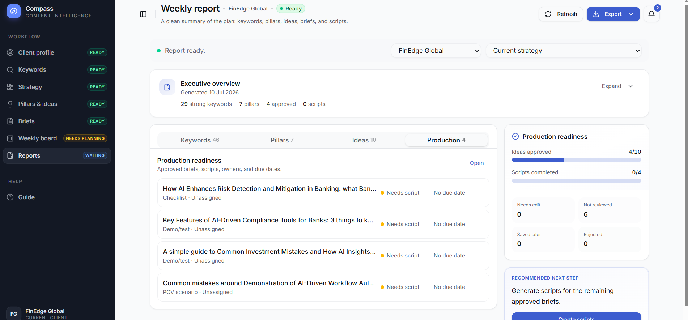 |

| Client Profile | Quality Explanation |
| --- | --- |
| 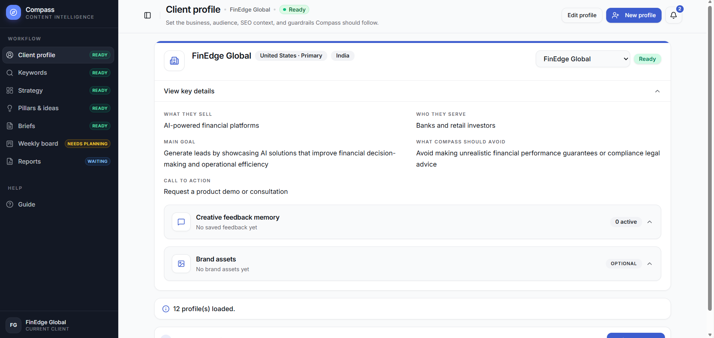 | 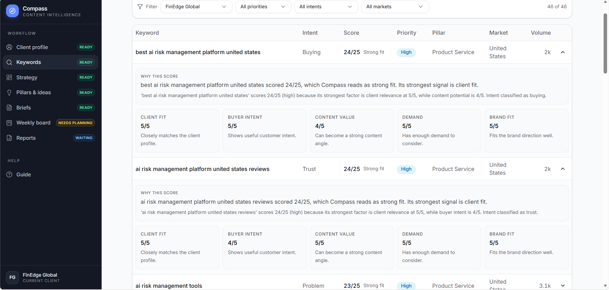 |

See the full screenshot index in [screenshots/README.md](screenshots/README.md).

## Documentation

| Section | Description |
| --- | --- |
| [Executive Summary](docs/01-executive-summary.md) | Portfolio-level overview and outcomes |
| [Business Problem](docs/02-business-problem.md) | Why Compass exists |
| [System Architecture](docs/03-system-architecture.md) | Components, integrations, and boundaries |
| [Data Collection Workflow](docs/04-data-collection-workflow.md) | Trend and source ingestion design |
| [Content Strategy Pipeline](docs/05-content-strategy-pipeline.md) | From client context to weekly plan |
| [Backend Design](docs/06-backend-design.md) | FastAPI modules and service boundaries |
| [Frontend Workspace](docs/07-frontend-workspace.md) | UX and product workflow |
| [API Overview](docs/08-api-overview.md) | Behavior-level endpoint map |
| [Data and Storage](docs/09-data-and-storage.md) | Local artifact strategy and data concepts |
| [Engineering Decisions](docs/10-engineering-decisions.md) | Trade-offs and rationale |
| [Challenges](docs/11-challenges.md) | Reliability, data quality, and UX constraints |
| [My Contributions](docs/12-my-contributions.md) | Technical ownership and portfolio framing |
| [Future Improvements](docs/13-future-improvements.md) | Production roadmap |
| [Appendix](docs/appendix.md) | Glossary, privacy notes, and review guide |

## Key Achievements

- Converted fragmented research steps into a guided strategy workflow.
- Balanced live data collection with visible source reliability and fallbacks.
- Kept AI useful but non-blocking through deterministic fallback paths.
- Built a frontend that feels like an operating workspace, not a raw API dashboard.
- Preserved portfolio safety by documenting architecture and reasoning without exposing credentials, raw data, or proprietary source.

## Lessons Learned

Compass reinforced that content AI systems need orchestration more than magic. The hardest work is not generating text; it is grounding recommendations in client context, surfacing confidence, making source failures visible, and helping humans approve the right next step.

## Repository Safety

This case study intentionally excludes `.env` files, API keys, local trend exports, scraped pages, logs, browser artifacts, private client data, and source-code dumps.
