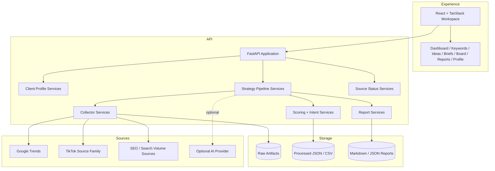

[Back to README](../README.md)

# System Architecture

Compass uses a modular prototype architecture: a FastAPI backend owns orchestration and persistence, while the React workspace presents a guided strategy experience.

## Component Responsibilities

| Component | Responsibility |
| --- | --- |
| React workspace | Guides the strategist through profile, research, approvals, board, and reports |
| FastAPI backend | Exposes API endpoints and coordinates strategy runs |
| Collector services | Retrieve Google Trends, TikTok, and SEO signals |
| Normalization services | Convert mixed source data into comparable strategy inputs |
| Scoring services | Rank opportunities by relevance, buyer intent, content potential, demand, and brand fit |
| AI services | Assist with suggestions and generation where enabled |
| Local storage | Keeps prototype artifacts inspectable and easy to debug |

## Architectural Boundary

Compass is intentionally not a production SaaS platform yet. The current design excludes authentication, billing, scheduled jobs, and database infrastructure so the prototype can focus on the strategy workflow and data-quality loop.
