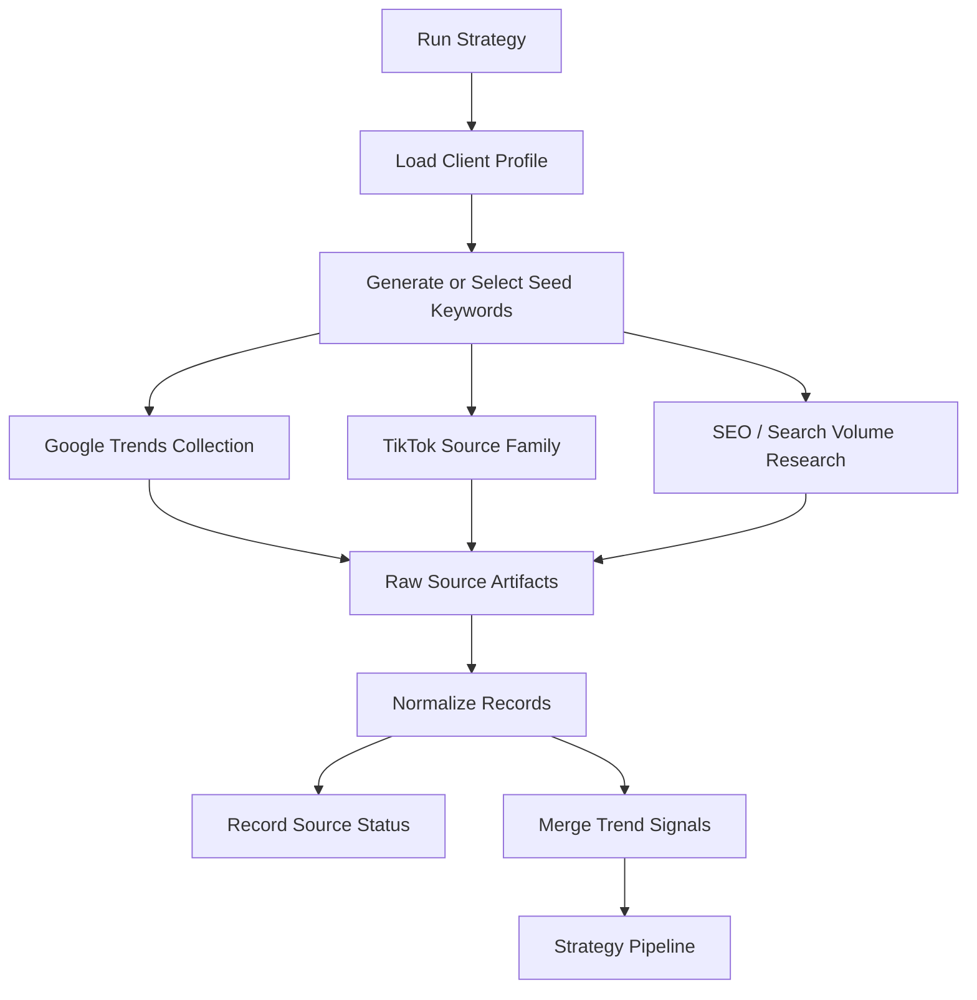

[Back to README](../README.md)

# Data Collection Workflow

Compass collects content signals from search and social sources, then converts them into strategy-ready inputs.

## Source Strategy

| Source | Role | Reliability Approach |
| --- | --- | --- |
| Google Trends | Search demand and trend direction | Uses official-style trend retrieval via `pytrends`; rate limits are surfaced |
| TikTok source family | Social discovery and short-form signals | Uses safer lanes such as Apify and optional diagnostics instead of aggressive scraping |
| SEO research | Keyword opportunity and content intent | Normalizes search-volume-like signals into planning inputs |
| Manual/sample data | Development and fallback testing | Keeps demos possible when live providers are unavailable |

## Safety Posture

Compass does not rely on login bypasses, CAPTCHA bypasses, stealth automation, or account-farming patterns. When a source is unavailable, the system records source status and continues with available evidence.
