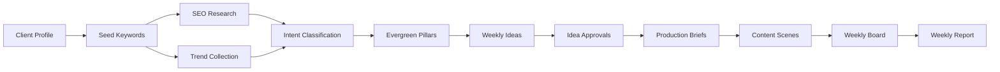
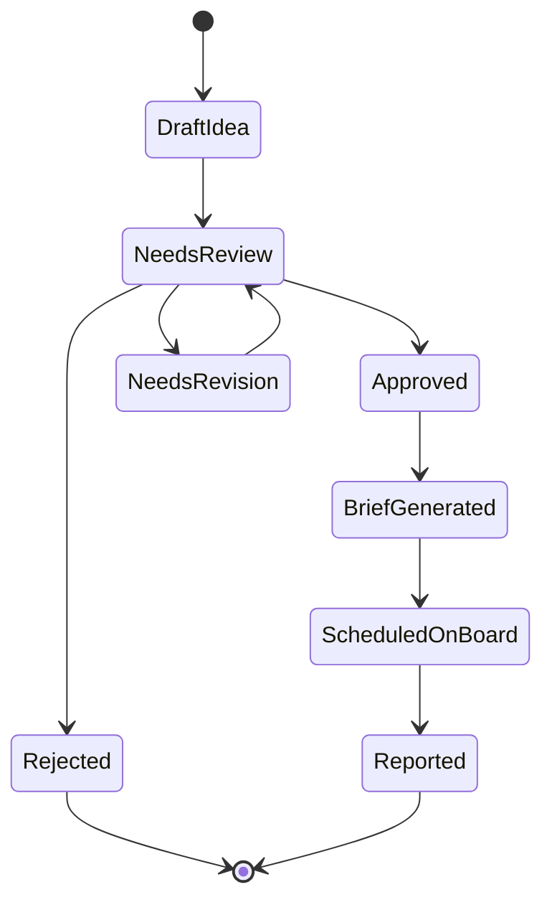

[Back to README](../README.md)

# Content Strategy Pipeline

The central workflow turns client context and external signals into a weekly production plan.

## Pipeline Stages

| Stage | Purpose |
| --- | --- |
| Client profile | Captures industry, offer, audience, market, tone, CTA, and risk boundaries |
| Seed keywords | Establishes the search and trend universe |
| SEO research | Expands topics and estimates demand |
| Intent classification | Labels buyer stage and content purpose |
| Pillar generation | Groups topics into durable strategic themes |
| Weekly ideas | Converts research into publishable content candidates |
| Approval workflow | Lets humans review, approve, reject, or move ideas |
| Production briefs | Creates more detailed creator-facing guidance |
| Weekly report | Summarizes strategy for operational or stakeholder review |

## AI Role

AI assists with ideation, summaries, and creative guidance. The workflow is designed so AI is useful but not a hard dependency: rule-based fallbacks and persisted artifacts keep the system operable when providers are unavailable.

