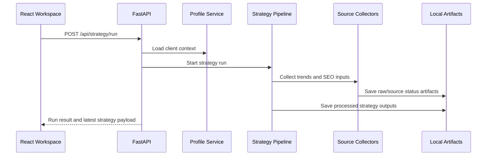

[Back to README](../README.md)

# Backend Design

The backend is a FastAPI application organized around service modules rather than a monolithic script. This makes the prototype easier to extend as the strategy workflow grows.

## Service Areas

| Area | Examples of Responsibility |
| --- | --- |
| Client profile | Create, update, assist, and retrieve client strategy context |
| Trend collection | Run Google Trends, TikTok, and related source adapters |
| Keyword research | Normalize topics, estimate demand, classify intent, and score quality |
| Strategy pipeline | Coordinate end-to-end strategy generation |
| Idea workflow | Track approvals and weekly board status |
| Content generation | Produce briefs, scenes, hooks, and feedback memory |
| Reports | Generate latest report artifacts and preview summaries |
| Source status | Surface collector availability and extraction warnings |

## Backend Flow

## Why This Design Works

- Service modules isolate unstable external sources from the rest of the system.
- Local artifacts make debugging and portfolio demonstration straightforward.
- API endpoints provide clear product boundaries for the frontend.
- Source status reporting prevents silent data-quality failures.

## Trade-Off

Local file persistence is excellent for prototype speed and transparency, but a production version would move job state, profiles, audit trails, and reports into a database-backed model.
