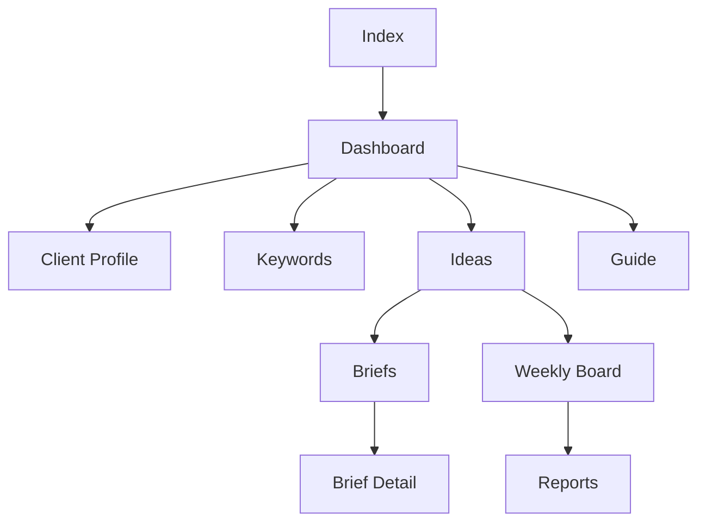

[Back to README](../README.md)

# Frontend Workspace

The frontend is a React/TanStack workspace designed around the strategist's workflow, not around backend implementation details.

## Key Views

| View | Purpose |
| --- | --- |
| Dashboard | Command center for latest run, source status, filters, and next steps |
| Profile | Client memory, audience context, brand tone, risk boundaries, and markets |
| Keywords | Keyword intents, search demand, scoring, and buyer-stage reasoning |
| Ideas | Weekly content ideas, quality explanations, and approval workflow |
| Briefs | Production-ready content guidance |
| Board | Weekly execution view for approved ideas |
| Reports | Stakeholder-facing strategy summary |
| Guide | Workflow support for users moving through Compass |

## UX Principle

The product is designed to reduce cognitive load. Strategists should always understand:

- which client is active;
- when the latest strategy was generated;
- which sources succeeded or failed;
- what the recommended next step is;
- why an idea is worth producing.

## Screenshot Placeholder

**File:** `dashboard.png`

Capture the full command center with demo client data, latest strategy timestamp, source status, cards, and navigation.

**Why it matters:** It gives reviewers the fastest visual proof that Compass is a complete workspace rather than a collection of scripts.
