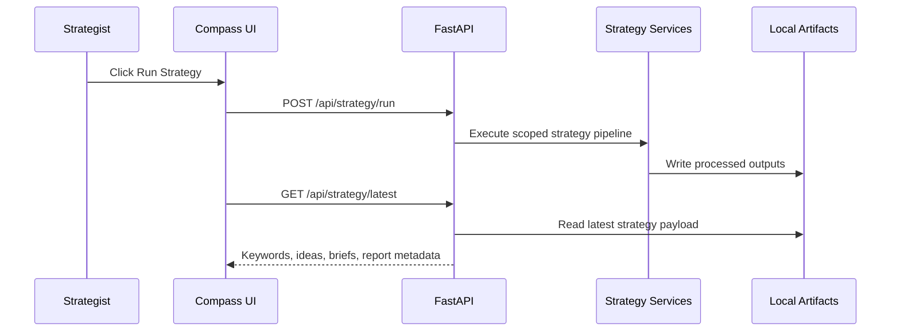

[Back to README](../README.md)

# API Overview

This overview documents endpoint behavior at a portfolio level. It avoids source dumps and internal implementation details.

## Endpoint Groups

| Group | Representative Endpoints | Purpose |
| --- | --- | --- |
| Health/config | `GET /health`, `GET /api/config/pusher` | Runtime health and optional frontend notification config |
| Client profiles | `GET/POST /api/client-profiles`, `GET /api/client-profiles/{profile_id}` | Manage client strategy context |
| Profile assistance | `POST /api/client-profiles/assist` | Help draft or enrich client profile fields |
| Brand assets | `GET/POST/DELETE /api/client-profiles/{profile_id}/brand-assets` | Store brand reference material |
| Strategy runs | `POST /api/strategy/run`, `GET /api/strategy/run-status/{profile_id}` | Trigger and observe strategy generation |
| SEO and keywords | `POST /api/strategy/seo-research`, `POST /api/strategy/keyword-intents` | Research and classify opportunities |
| Strategy output | `POST /api/strategy/content-universe`, `POST /api/strategy/evergreen-pillars`, `POST /api/strategy/output` | Generate strategic planning layers |
| Ideas and board | `GET/PATCH /api/strategy/idea-approvals/{profile_id}`, `GET/PATCH /api/strategy/weekly-board/{profile_id}` | Review, approve, and organize ideas |
| Briefs and scenes | `GET/POST /api/strategy/content-scenes/{profile_id}/{idea_id}` | Generate and refine creator-facing scenes |
| Reports | `GET /api/strategy/weekly-report/latest`, `GET /api/reports/latest` | Return report previews and artifacts |
| Trend diagnostics | `POST /api/trends/run`, `GET /api/trends/latest`, `GET /api/sources/status`, `GET /api/tiktok/status` | Run and inspect trend-source collection |

## API Design Notes

- Endpoints are grouped by workflow stage.
- Latest-result endpoints keep the frontend simple during prototype iteration.
- Profile-scoped endpoints prepare the system for multi-client use.
- Diagnostic endpoints make external-source reliability visible.

## Sequence Diagram

