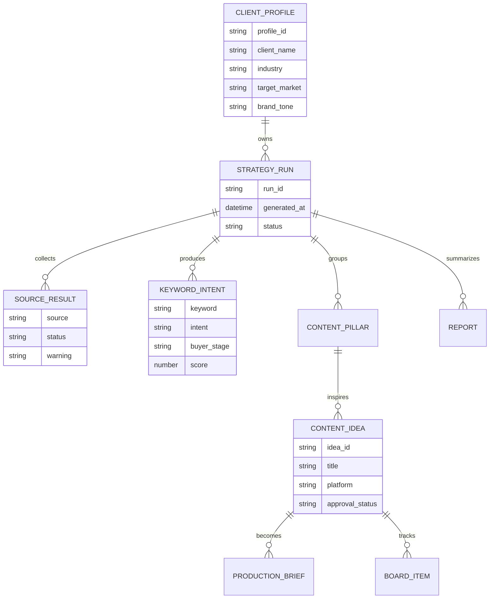

[Back to README](../README.md)

# Data and Storage

Compass uses local artifact storage for prototype speed, transparency, and debugging.

## Storage Model

## Artifact Types

| Artifact | Purpose |
| --- | --- |
| Raw source files | Debug collector behavior and source failures |
| Processed JSON/CSV | Store latest trends, intents, ideas, briefs, and source status |
| Markdown reports | Make weekly outputs readable outside the app |
| Frontend state | Remembers active profile and workflow context in the browser |

## Production Upgrade Path

A production Compass would move from local files to a relational database plus object storage:

- profiles, runs, ideas, briefs, approvals, and audit history in PostgreSQL;
- source artifacts and brand assets in object storage;
- asynchronous strategy jobs in a queue;
- versioned reports for client delivery.

> [!IMPORTANT]
> This case study does not include raw trend exports, local client outputs, logs, or generated report artifacts from the working project.
